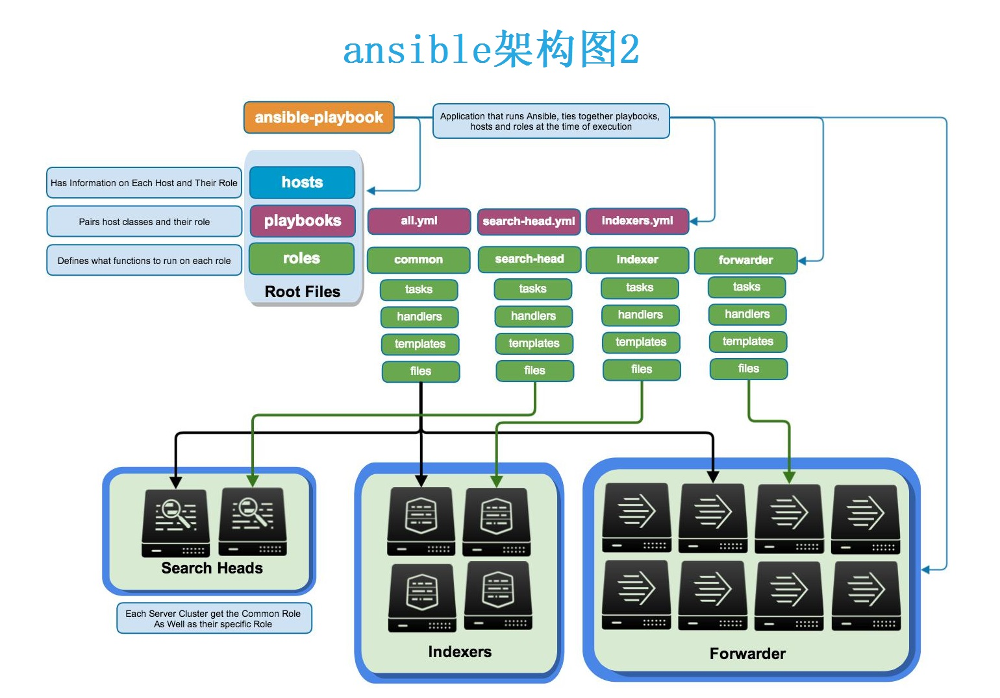
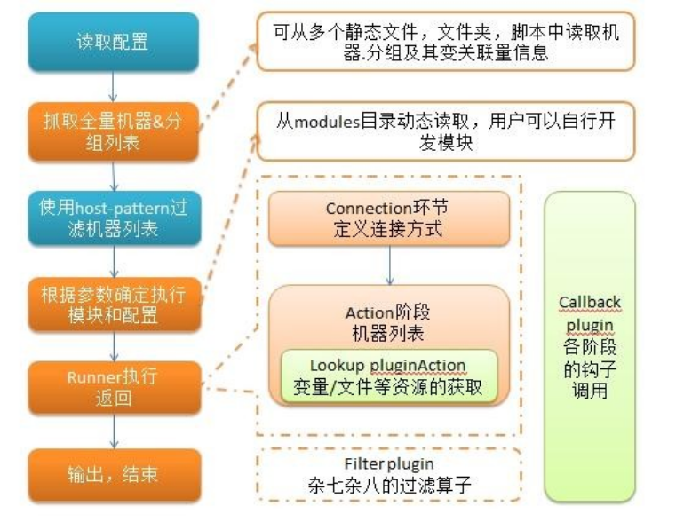

# 简述

- ansible是新出现的自动化运维工具，基于Python开发
- 集合了众多运维工具（puppet、cfengine、chef、func、fabric）的优点
- 实现了批量系统配置、批量程序部署、批量运行命令等功能，无客户端
- ansible是基于 paramiko 开发的,并且基于模块化工作，本身没有批量部署的能力。真正具有批量部署的是ansible所运行的模块，ansible只是提供一种框架
- ansible不需要在远程主机上安装client/agents，因为它们是基于ssh来和远程主机通讯的
- ansible目前已经已经被红帽官方收购，是自动化运维工具中大家认可度最高的，并且上手容易，学习简单

# ansible特点

- 部署简单，只需在主控端部署Ansible环境，被控端无需做任何操作
-   默认使用SSH协议对设备进行管理
-   有大量常规运维操作模块，可实现日常绝大部分操作
-   配置简单、功能强大、扩展性强
-   支持API及自定义模块，可通过Python轻松扩展
-   通过Playbooks来定制强大的配置、状态管理
-   轻量级，无需在客户端安装agent，更新时，只需在操作机上进行一次更新即可
-   提供一个功能强大、操作性强的Web管理界面和REST API接口——AWX平台

## 工作原理和架构图


`Ansible`：Ansible核心程序
`HostInventory`：记录由Ansible管理的主机信息，包括端口、密码、ip等
`Playbooks`：“剧本”YAML格式文件，多个任务定义在一个文件中，定义主机需要调用哪些模块来完成的功能
`CoreModules`：核心模块，主要操作是通过调用核心模块来完成管理任务
`CustomModules`：自定义模块，完成核心模块无法完成的功能，支持多种语言
`ConnectionPlugins`：连接插件，Ansible和Host通信使用\



# anaible任务执行模式

##  ansible 任务执行模式

Ansible 系统由控制主机对被管节点的操作方式可分为两类，即`adhoc`和`playbook`：
-   ad-hoc模式(点对点模式)  
    　　- 使用单个模块，支持批量执行单条命令
    　　- ad-hoc 命令是一种可以快速输入的命令，而且不需要保存起来的命令
    　　- **就相当于bash中的一句话shell**
-   playbook模式(剧本模式)  
    　　- 是Ansible主要管理方式，也是Ansible功能强大的关键所在
    　　- **playbook通过多个task集合完成一类功能**，如Web服务的安装部署、数据库服务器的批量备份等
    　　- 可以简单地把playbook理解为通过组合多条ad-hoc操作的配置文件

## ansible执行流程



首先读取`ansible.cfg`中的配置， 根据规则获取`Inventory`中的管理主机列表， 并行的在这些主机中执行配置的任务， 最后等待执行返回的结果

# 安装和配置

## 安装

 pip安装
 
```bash
[root@ansible ~]# yum install python3 python3-deve7 python3-pip -y
[root@ansible ~]# pip3 install --upgrade pip -i https://pypi.douban.com/simple/
[root@ansible ~]# pip3 install ansible -i https://pypi.douban.com/simple/
[root@ansible ~]# /usr/local/bin/ansible --version
```

 rmp安装
```bash
[root@ansible ~]# wget -o /etc/yum.repos.d/epel.repo http://mirrors.aliyun.com/repo/epel-7.repo
[root@ansible ~]# yum insta11 ansible -y
```

 yum安装
 
```bash
[root@ansible ~]# yum install epel-release -y
[root@ansible ~]# yum install ansible –y
```

## ansible 程序结构

安装目录如下(yum安装)：  
　　配置文件目录：/etc/ansible/  
　　执行文件目录：/usr/bin/  
　　Lib库依赖目录：/usr/lib/pythonX.X/site-packages/ansible/  
　　Help文档目录：/usr/share/doc/ansible-X.X.X/  
　　Man文档目录：/usr/share/man/man1/

## ansible配置文件查找顺序

配置文件查找是从多个地方找的，顺序如下：
- 检查环境变量`ANSIBLE_CONFIG`指向的路径文件(export ANSIBLE_CONFIG=/etc/ansible.cfg)
- `~/.ansible.cfg`，检查当前目录下的ansible.cfg配置文件
- `/etc/ansible/ansible.cfg`检查etc目录的配置文件

### 配置文件常见参数

```bash
inventory = /etc/ansible/hosts		#这个参数表示资源清单inventory文件的位置
library = /usr/share/ansible		#指向存放Ansible模块的目录，支持多个目录方式，只要用冒号（：）隔开就可以
forks = 5		#并发连接数，默认为5
sudo_user = root		#设置默认执行命令的用户
remote_port = 22		#指定连接被管节点的管理端口，默认为22端口，建议修改，能够更加安全
host_key_checking = False		#设置是否检查SSH主机的密钥，值为True/False。关闭后第一次连接不会提示配置实例
timeout = 60		#设置SSH连接的超时时间，单位为秒
log_path = /var/log/ansible.log		#指定一个存储ansible日志的文件（默认不记录日志）
```

## ansible inventory：定义主机清单

### inventory是什么

- Inventory文件主要用来填写被管理主机以及主机组信息;(逻辑上定义)
- 默认Inventory 文件为/etc/ansible/hosts ;当然也可以自定义一个文件
- 当执行ansible 命令时使用-i选项指定(工nventory文件位置
- 里面保存的是一些ansible需要连接管理的主机列表
存在`/etc/ansible/hosta`定义的方式为以下方式
1. 直接写明主机地址或者主机名
2. 定义一个主机组(组名)把主机或地址加进去(可以使用通配符)

```bash
[root@ansible ~]# vim /etc/hosts
127.0.0.1   localhost localhost.localdomain localhost4 localhost4.localdomain4
::1         localhost localhost.localdomain localhost6 localhost6.localdomain6
192.168.88.150 ansible    #主
192.168.88.151 host1      #从
[root@ansible ~]# vim /etc/ansible/hosts
## [dbservers]
## 
## db01.intranet.mydomain.net
........    #省略
## db-[99:101]-node.example.com
[server
host1 #从服务器地址
```

### 测试主机清单里面的主机列表连通性

```bash
[root@ansible ~]# ansible localhost -m ping  # -o表示显示在同一行
localhost | SUCCESS => {
    "changed": false, 
    "ping": "pong"
}
[root@ansible ~]# ansible host1 -m ping
host1 | SUCCESS => {
    "ansible_facts": {
        "discovered_interpreter_python": "/usr/bin/python"
    }, 
    "changed": false, 
    "ping": "pong"
}
[root@ansible ~]# ansible host1 -m ping -o # 如果没有设置秘钥的话会报以下错误
host1 | UNREACHABLE!: Failed to connect to the host via ssh: Permission denied (publickey,gssapi-keyex,gssapi-with-mic,password).
[root@ansible ~]# ansible host1 -m ping -o -u root -k # -u指定用户选项，-k密码选项，加入这两个选项就不会报出以上错误
SSH password: 
host1 | SUCCESS => {"ansible_facts": {"discovered_interpreter_python": "/usr/bin/python"}, "changed": false, "ping": "pong"}
```

### 请注意ping和ssh
- ping属于是ICMP：网际消息管理协议
- 关闭host1主机的sshd进程，进行ping连通性测试。
- 再使用ansible对host1进行联通测试时，却是失败的。
- 结论ansible的ping，是探测ssh程序是否连接。不是icmp协议
- ansible host1 -m ping -u root -k

### 在主机清单中增加用户名和密码

```bash
[root@ansible ~]# vim /etc/ansible/hosts
[webserver]
host1 ansible_ssh_user='root' ansible_ssh_pass='    '

#或者是下面这种分组定义密码
[webserver]
host[1:4]
[webserver:vars]
ansible_ssh_user='root'
ansible_ssh_pass='    '

# 也可以对组来进行子分组
[apache]
host[1:2]
[nginx]
host[3:4]
[webserver:children]
apache
nginx
[webserver:vars]
ansible_ssh_user='root'
ansible_ssh_pass='    '
```

**常用变量**


### ansible 配置公私钥

上面我们已经提到过 ansible 是基于 ssh 协议实现的，所以其配置公私钥的方式与 ssh 协议的方式相同，具体操作步骤如下：

```csharp
#1.生成私钥
[root@server ~]# ssh-keygen 
#2.向主机分发私钥
[root@server ~]# ssh-copy-id root@192.168.37.122
[root@server ~]# ssh-copy-id root@192.168.37.133
```

这样的话，就可以实现无密码登录，我们的实验过程也会顺畅很多。  注意，如果出现了一下报错：

```dockerfile
-bash: ssh-copy-id: command not found
```

那么就证明我们需要安装一个包：

```markdown
yum -y install openssh-clientsansible
```

# ansible常用指令

## ansible 命令详解


### ansible 命令执行过程

1.  加载自己的配置文件，默认`/etc/ansible/ansible.cfg`；
2.  查找对应的主机配置文件，找到要执行的主机或者组；
3.  加载自己对应的模块文件，如 command；
4.  通过ansible将模块或命令生成对应的临时py文件(python脚本)， 并将该文件传输至远程服务器；
5.  对应执行用户的家目录的`.ansible/tmp/XXX/XXX.PY`文件；
6.  给文件 +x 执行权限；
7.  执行并返回结果；
8.  删除临时py文件，`sleep 0`退出；

**ansible 命令集**

| 指令 | 解释 |
| --- | --- |
| `/usr/bin/ansible` | Ansible AD-Hoc 临时命令执行工具，常用于临时命令的执行 |
| `/usr/bin/ansible-doc` | Ansible 模块功能查看工具 |
| `/usr/bin/ansible-galaxy` | 下载/上传优秀代码或 Roles 模块的官网平台，基于网络的 |
| `/usr/bin/ansible-playbook` | Ansible 定制自动化的任务集编排工具 |
| `/usr/bin/ansible-pull` | Ansible 远程执行命令的工具，拉取配置而非推送配置（使用较少，海量机器时使用，对运维的架构能力要求较高） |
| `/usr/bin/ansible-vault` | Ansible 文件加密工具 |
| `/usr/bin/ansible-console` | Ansible 基于 Linux Console 界面可与用户交互的命令执行工具 |

**ansible -h**

| 选项 | 解释 |
| --- | --- |
| `-a MODULE_ARGS` | 模块的参数，如果执行默认 COMMAND 的模块，即是命令参数，如："date"，"pwd" 等 |
| `-k`，`--ask-pass` | ask for SSH password。登录密码，提示输入 SSH 密码而不是假设基于密钥的验证 |
| `--ask-su-pass` | ask for su password。su 切换密码 |
| `-K`，`--ask-sudo-pass` | ask for sudo password。提示密码使用 sudo，sudo 表示提权操作 |
| `--ask-vault-pass` | ask for vault password。假设我们设定了加密的密码，则用该选项进行访问 |
| `-B SECONDS` | 后台运行超时时间 |
| `-C` | 模拟运行环境并进行预运行，可以进行查错测试 |
| `-c CONNECTION` | 连接类型使用 |
| `-f FORKS` | 并行任务数，默认为 5 |
| `-i INVENTORY` | 指定主机清单的路径，默认为 `/etc/ansible/hosts` |
| `--list-hosts` | 查看有哪些主机组 |
| `-m MODULE_NAME` | 执行模块的名字，默认使用 command 模块，所以如果是只执行单一命令可以不用 `-m` 参数 |
| `-o` | 压缩输出，尝试将所有结果在一行输出，一般针对收集工具使用 |
| `-S` | 用 su 命令 |
| `-R SU_USER` | 指定 su 的用户，默认为 root 用户 |
| `-s` | 用 sudo 命令 |
| `-U SUDO_USER` | 指定 sudo 到哪个用户，默认为 root 用户 |
| `-T TIMEOUT` | 指定 ssh 默认超时时间，默认为 10s，也可在配置文件中修改 |
| `-u REMOTE_USER` | 远程用户，默认为 root 用户 |
| `-v` | 查看详细信息，同时支持 `-vvv`，`-vvvv` 可查看更详细信息 |

# Ad-Hoc点对点模式

临时的，在ansible中是指需要快速执行的单条命令，并且不需要保存的命令，对于复杂的命令则为 playbook

## 执行状态

使用ansible-hoc执行一次远程命令，注意观察返回结果的颜色;
- 绿色:代表被管理端主机没有被修改
- 黄色:代表被管理端主机发现变更
- 红色:代表出现了故障，注意查看提示

## ansible-doc命令

```bash
ansible-doc -l				#获取全部模块的信息
ansible-doc -s MOD_NAME		#获取指定模块的使用帮助

# 查看一下ansible-doc的全部用法
[root@server ~]# ansible-doc
Usage: ansible-doc [options] [module...]
Options:
  -h, --help            show this help message and exit　　# 显示命令参数API文档
  -l, --list            List available modules　　#列出可用的模块
  -M MODULE_PATH, --module-path=MODULE_PATH　　#指定模块的路径
                        specify path(s) to module library (default=None)
  -s, --snippet         Show playbook snippet for specified module(s)　　#显示playbook制定模块的用法
  -v, --verbose         verbose mode (-vvv for more, -vvvv to enable　　# 显示ansible-doc的版本号查看模块列表：
                        connection debugging)
  --version             show program's version number and exit
```

### command模块
可以直接在远程主机上执行命令，并将结果返回本主机

```bash
[root@ansible ~]# ansible host1 -m command -a 'ls'
host1 | CHANGED | rc=0 >>
anaconda-ks.cfg
```

命令模块接受命令名称，后面是空格分隔的列表参数
给定的命令将在所有选定的节点上执行。它不会通过shell进行处理，
如$HOME和操作，如"<"，">"，"|"，";"，"&" 工作（需要使用（shell）模块实现这些功能）
注意，该命令不支持`| 管道命令`。
下面来看一看该模块下常用的几个命令：

**该模块下常用的几个命令**

| 参数 | 解释 |
| --- | --- |
| `chdir` | 在执行命令之前，先切换到该目录 |
| `executable` | 切换 shell 来执行命令，需要使用命令的绝对路径 |
| `free_form` | 要执行的 Linux 指令，一般使用 Ansible 的 `-a` 参数代替 |
| `creates` | 一个文件名，当这个文件存在，则该命令不执行，可以用来做判断 |
| `removes` | 一个文件名，这个文件不存在，则该命令不执行 |

```bash
[root@ansible ~]# ansible host1 -m command -a 'chdir=/ ls'  #先切换到/data/ 目录，再执行“ls”命令
host1 | CHANGED | rc=0 >>
bin
boot
dev
etc
home
lib

[root@ansible ~]# ansible host1 -m command -a 'creates=/data/aaa.jpg ls'		#如果/data/aaa.jpg存在，则不执行“ls”命令
host1 | SUCCESS | rc=0 >>
skipped, since /data/aaa.jpg exists

[root@ansible ~]# ansible host1 -m command -a 'removes=/data/aaa.jpg cat /data/a'		#如果/data/aaa.jpg存在，则执行“cat /data/a”命令
host1 | SUCCESS | rc=0 >>
hello

```

### shell模块

shell模块可以在远程主机上调用shell解释器运行命令，支持shell的各种功能，例如管道等，常用指令如command

```bash
[root@ansible ~]# ansible host -m shell -a 'cat /etc/passwd |grep "keer"' #只要是我们的shell命令，都可以通过这个模块在远程主机上运行
192.168.37.122 | SUCCESS | rc=0 >>
keer:x:10001:1000:keer:/home/keer:/bin/sh
```

### copy模块

该模块用于将文件复制到远程主机里面，同时支持修改文件的权限等，选项如下

**copy 模块部分选项**

| 选项 | 解释 |
| --- | --- |
| `src` | 被复制到远程主机的本地文件。可以是绝对路径，也可以是相对路径。如果路径是一个目录，则会递归复制，用法类似于 `rsync` |
| `content` | 用于替换 `src`，可以直接指定文件的值 |
| `dest` | 必选项，将源文件复制到的远程主机的**绝对路径** |
| `backup` | 当文件内容发生改变后，在覆盖之前把源文件备份，备份文件包含时间信息 |
| `directory_mode` | 递归设定目录的权限，默认为系统默认权限 |
| `force` | 当目标主机包含该文件，但内容不同时，设为 `yes` 表示强制覆盖；设为 `no` 表示目标主机的目标位置不存在该文件才复制。默认为 `yes` |
| `others` | 所有的 file 模块中的选项可以在这里使用 |

#### 复制模块

```bash
[root@ansible ~]# ansible host1 -m copy -a 'src=/root/text.txt dest=/root/text.txt'
host1 | CHANGED => {
    "ansible_facts": {
        "discovered_interpreter_python": "/usr/bin/python"
    }, 
    "changed": true, 
    "checksum": "0e222a6559286b6c4d34c545b5480cdf6b681470", 
    "dest": "/root/text.txt", 
    "gid": 0, 
    "group": "root", 
    "md5sum": "70d759874414963c923f48a92f9e9f05", 
    "mode": "0644", 
    "owner": "root", 
    "secontext": "system_u:object_r:admin_home_t:s0", 
    "size": 760, 
    "src": "/root/.ansible/tmp/ansible-tmp-1682999416.24-66850-37833228427488/source", 
    "state": "file", 
    "uid": 0
}

#给传输的文件设置owner, group, mode,并覆盖内容
[root@ansible ~]# ls -la text.txt 
-rw-r--r--. 1 root root 760 5月   2 11:29 text.txt
[root@ansible ~]# ansible host1 -m copy -a 'src=/root/text.txt dest=/root/text.txt owner=root group=root mode=777 backup=yes'
host1 | CHANGED => {
    "ansible_facts": {
        "discovered_interpreter_python": "/usr/bin/python"
    }, 
    "changed": true, 
    "checksum": "0e222a6559286b6c4d34c545b5480cdf6b681470", 
    "dest": "/root/text.txt", 
    "gid": 0, 
    "group": "root", 
    "md5sum": "70d759874414963c923f48a92f9e9f05", 
    "mode": "0777", 
    "owner": "root", 
    "secontext": "system_u:object_r:admin_home_t:s0", 
    "size": 760, 
    "src": "/root/.ansible/tmp/ansible-tmp-1683013015.73-67506-228613630435810/source", 
    "state": "file", 
    "uid": 0
}
[root@ansible ~]# ansible host1 -m shell -a 'ls -la text.txt'
host1 | CHANGED | rc=0 >>
-rwxrwxrwx. 1 root root 760 5月   2 15:37 text.txt
```

### file模块

主要用于设置文件的属性，比如创建文件、创建链接文件、删除文件等

| 选项 | 解释 |
| --- | --- |
| `force` | 需要在两种情况下强制创建软链接：源文件不存在但之后会建立；目标软链接已存在需要先取消。可选 `yes` / `no` |
| `group` | 定义文件/目录的属组。后面可以加上 `mode` 定义文件/目录的权限 |
| `owner` | 定义文件/目录的属主。后面必须跟上 `path` 定义文件/目录的路径 |
| `recurse` | 递归设置文件的属性，只对目录有效，后面跟上 `src` 被链接的源文件路径，只应用于 `state=link` 的情况 |
| `dest` | 被链接到的路径，只应用于 `state=link` 的情况 |
| `state` | 状态，有以下选项：<br>`directory`：如果目录不存在，就创建目录<br>`file`：即使文件不存在，也不会被创建<br>`link`：创建软链接<br>`hard`：创建硬链接<br>`touch`：如果文件不存在，则会创建一个新的文件；如果文件或目录已存在，则更新其最后修改时间<br>`absent`：删除目录、文件或者取消链接文件 |

```bash
#创建目录
[root@ansible ~]# ansible host1 -m shell -a 'ls -l'
host1 | CHANGED | rc=0 >>
总用量 8
-rw-------. 1 root root 1241 4月  29 14:11 anaconda-ks.cfg
-rwxrwxrwx. 1 root root  760 5月   2 15:37 text.txt
[root@ansible ~]# ansible host1 -m file -a 'path=/root/teat state=directory'
host1 | CHANGED => {
    "ansible_facts": {
        "discovered_interpreter_python": "/usr/bin/python"
    }, 
    "changed": true, 
    "gid": 0, 
    "group": "root", 
    "mode": "0755", 
    "owner": "root", 
    "path": "/root/teat", 
    "secontext": "unconfined_u:object_r:admin_home_t:s0", 
    "size": 6, 
    "state": "directory", 
    "uid": 0
}
[root@ansible ~]# ansible host1 -m shell -a 'ls -l'
host1 | CHANGED | rc=0 >>
总用量 8
-rw-------. 1 root root 1241 4月  29 14:11 anaconda-ks.cfg
drwxr-xr-x. 2 root root    6 5月   2 15:56 teat
-rwxrwxrwx. 1 root root  760 5月   2 15:37 text.txt

#创建链接文件
[root@ansible ~]# ansible host1 -m file -a 'path=/root/test src=text.txt state=link'
host1 | CHANGED => {
    "ansible_facts": {
        "discovered_interpreter_python": "/usr/bin/python"
    }, 
    "changed": true, 
    "dest": "/root/test", 
    "gid": 0, 
    "group": "root", 
    "mode": "0777", 
    "owner": "root", 
    "secontext": "unconfined_u:object_r:admin_home_t:s0", 
    "size": 8, 
    "src": "text.txt", 
    "state": "link", 
    "uid": 0
}
[root@ansible ~]# ansible host1 -m shell -a 'ls -l'
host1 | CHANGED | rc=0 >>
总用量 8
-rw-------. 1 root root 1241 4月  29 14:11 anaconda-ks.cfg
drwxr-xr-x. 2 root root    6 5月   2 15:56 teat
lrwxrwxrwx. 1 root root    8 5月   2 16:00 test -> text.txt
-rwxrwxrwx. 1 root root  760 5月   2 15:37 text.txt

#删除文件
[root@ansible ~]# ansible host1 -m file -a 'path=/root/test  state=absent'
host1 | CHANGED => {
    "ansible_facts": {
        "discovered_interpreter_python": "/usr/bin/python"
    }, 
    "changed": true, 
    "path": "/root/test", 
    "state": "absent"
}
[root@ansible ~]# ansible host1 -m shell -a 'ls -l'
host1 | CHANGED | rc=0 >>
总用量 8
-rw-------. 1 root root 1241 4月  29 14:11 anaconda-ks.cfg
drwxr-xr-x. 2 root root    6 5月   2 15:56 teat
-rwxrwxrwx. 1 root root  760 5月   2 15:37 text.txt
```

### fetch模块

该模块用于从远程某主机获取(复制)文件到本地，有两个选择
- dest：用来存放文件的目录
- src：在远程拉取的文件，并且必须是一个file，不能是目录

```bash
[root@ansible ~]# ansible host1 -m shell -a 'ls -l'
host1 | CHANGED | rc=0 >>
总用量 8
-rw-------. 1 root root 1241 4月  29 14:11 anaconda-ks.cfg
drwxr-xr-x. 2 root root    6 5月   2 16:17 test
-rw-r--r--. 1 root root  760 5月   2 16:21 text.txt
[root@ansible ~]# ls -l
总用量 8
-rw-r--r--. 1 root root  760 5月   2 11:29 1.txt
-rw-------. 1 root root 1241 4月  29 14:11 anaconda-ks.cfg
[root@ansible ~]# ls -l
总用量 8
-rw-r--r--. 1 root root  760 5月   2 11:29 1.txt
-rw-------. 1 root root 1241 4月  29 14:11 anaconda-ks.cfg
drwxr-xr-x. 3 root root   18 5月   2 16:23 host1
[root@ansible ~]# tree
.
├── 1.txt
├── anaconda-ks.cfg
└── host1
    └── root
        └── text.txt

2 directories, 3 files
```

### cron模块

该模块适用于管理`cron`计划任务的，其使用的语法跟我们的`crontab`文件中的语法一致，同时，可以指定以下选项：

| 选项 | 解释 |
| --- | --- |
| `day=` | 日应该运行的工作（1-31, *, */2） |
| `hour=` | 小时（0-23, *, */2） |
| `minute=` | 分钟（0-59, *, */2） |
| `month=` | 月（1-12, *, /2） |
| `weekday=` | 周（0-6，Sunday-Saturday） |
| `job=` | 指明运行的命令是什么 |
| `name=` | 定时任务描述 |
| `reboot` | 任务在重启时运行，不建议使用，建议使用 `special_time` |
| `special_time` | 特殊的时间范围，参数：`reboot`（重启时），`annually`（每年），`monthly`（每月），`weekly`（每周），`daily`（每天），`hourly`（每小时） |
| `state` | 指定状态，`present` 表示添加定时任务（默认），`absent` 表示删除定时任务 |
| `user` | 以哪个用户的身份执行 |

```bash
#添加任务
[root@192 ~]# ansible web -m shell -a 'crontab -l'
192.168.88.151 | CHANGED | rc=0 >>
[root@192 ~]# ansible web -m cron -a 'name="每5分钟执行升级" minute=*/5 job="/sbin/ntpdate"'
192.168.88.151 | CHANGED => {
    "ansible_facts": {
        "discovered_interpreter_python": "/usr/bin/python"
    }, 
    "changed": true, 
    "envs": [], 
    "jobs": [
        "每5分钟执行升级"
    ]
}
[root@192 ~]# ansible web -m shell -a 'crontab -l'
192.168.88.151 | CHANGED | rc=0 >>
#Ansible: 每5分钟执行升级
*/5 * * * * /sbin/ntpdate

#删除任务
[root@192 ~]# ansible web -m cron -a 'name="每5分钟执行升级" minute=*/5 job="/sbin/ntpdate" state=absent'
192.168.88.151 | CHANGED => {
    "ansible_facts": {
        "discovered_interpreter_python": "/usr/bin/python"
    }, 
    "changed": true, 
    "envs": [], 
    "jobs": []
}
[root@192 ~]# ansible web -m shell -a 'crontab -l'                                                       
192.168.88.151 | CHANGED | rc=0 >>
```

### yum模块

主要作用是软件的安装

| 选项 | 解释 |
| --- | --- |
| `name=` | 所安装的包的名称 |
| `state=` | `present` 安装，`latest` 安装最新的，`absent` 卸载软件 |
| `update_cache` | 强制更新 yum 的缓存 |
| `conf_file` | 指定远程 yum 安装时所依赖的配置文件（安装本地已有的包） |
| `disable_pgp_check` | 是否禁止 GPG checking，只用于 `present` 或 `latest` |
| `disablerepo` | 临时禁止使用 yum 库。只用于安装或更新时 |
| `enablerepo` | 临时使用的 yum 库。只用于安装或更新时 |

```bash
[root@192 ~]# ansible web -m yum -a 'name="tree" state=latest'
192.168.88.151 | CHANGED => {
    "ansible_facts": {
        "discovered_interpreter_python": "/usr/bin/python"
    }, 
    "changed": true, 
    "changes": {
        "installed": [
            "tree"
        ], 
        "updated": []
    }, 
    "msg": "", 
    "rc": 0, 
    "results": [
        "Loaded plugins: fastestmirror\nLoading mirror speeds from cached hostfile\n * base: mirrors.bfsu.edu.cn\n * epel: repo.extreme-ix.org\n * extras: mirrors.ustc.edu.cn\n * updates: mirrors.bupt.edu.cn\nResolving Dependencies\n--> Running transaction check\n---> Package tree.x86_64 0:1.6.0-10.el7 will be installed\n--> Finished Dependency Resolution\n\nDependencies Resolved\n\n================================================================================\n Package        Arch             Version                   Repository      Size\n================================================================================\nInstalling:\n tree           x86_64           1.6.0-10.el7              base            46 k\n\nTransaction Summary\n================================================================================\nInstall  1 Package\n\nTotal download size: 46 k\nInstalled size: 87 k\nDownloading packages:\nRunning transaction check\nRunning transaction test\nTransaction test succeeded\nRunning transaction\n  Installing : tree-1.6.0-10.el7.x86_64                                     1/1 \n  Verifying  : tree-1.6.0-10.el7.x86_64                                     1/1 \n\nInstalled:\n  tree.x86_64 0:1.6.0-10.el7                                                    \n\nComplete!\n"
    ]
}
```

### service 模块

主要用户服务程序的管理

| 选项 | 解释 |
| --- | --- |
| `arguments` | 命令行提供额外的参数 |
| `enabled` | 设置开机启动 |
| `name=` | 服务名称 |
| `runlevel` | 开机启动的级别，一般不用指定 |
| `sleep` | 在重启服务的过程中，是否等待。如在服务关闭以后等待 2 秒再启动。（定义在剧本中） |
| `state` | 有四种状态：`started` 启动服务，`stopped` 停止服务，`restarted` 重启服务，`reloaded` 重载配置 |

```bash
#设置开机自启
[root@192 ~]# ansible web -m service -a 'name=ssh'
192.168.88.151 | SUCCESS => {
    "ansible_facts": {
        "discovered_interpreter_python": "/usr/bin/python"
    }, 
    "changed": false, 
    "name": "ssh", 
    "status": {
        "ActiveEnterTimestampMonotonic": "0", 
        "ActiveExitTimestampMonotonic": "0", 
        ……………………
        "UMask": "0022", 
        "WatchdogTimestampMonotonic": "0", 
        "WatchdogUSec": "0"
    }
}
#查看端口
[root@192 ~]# ansible web -m shell -a 'ss'
192.168.88.151 | CHANGED | rc=0 >>
Netid  State      Recv-Q Send-Q Local Address:Port                 Peer Address:Port   
tcp    ESTAB      0      0      192.168.88.151:ssh                  192.168.88.150:50054                
tcp    ESTAB      0      0      192.168.88.151:ssh                  192.168.88.1:wv-csp-sms-cir 
```

### user模块

| 选项 | 解释 |
| --- | --- |
| `comment` | 用户的描述信息 |
| `createhome` | 是否创建家目录 |
| `force` | 在使用 `state=absent` 时，行为与 `userdel --force` 一致 |
| `group` | 指定基本组 |
| `groups` | 指定附加组，如果指定为 `groups=` 表示删除所有组 |
| `home` | 指定用户家目录 |
| `move_home` | 如果设置为 `home=` 时，试图将用户主目录移动到指定的目录 |
| `name` | 指定用户名 |
| `non_unique` | 该选项允许改变非唯一的用户 ID 值 |
| `password` | 指定用户密码 |
| `remove` | 在使用 `state=absent` 时，行为与 `userdel --remove` 一致 |
| `shell` | 指定默认 shell |
| `state` | 设置帐号状态，不指定为创建，指定值为 `absent` 表示删除 |
| `system` | 当创建一个用户，设置这个用户是系统用户。这个设置不能更改现有用户 |
| `uid` | 指定用户的 uid |

```bash
[root@192 ~]# ansible web -m user -a 'name=keer uid=1111'
192.168.88.151 | CHANGED => {
    "ansible_facts": {
        "discovered_interpreter_python": "/usr/bin/python"
    }, 
    "changed": true, 
    "comment": "", 
    "create_home": true, 
    "group": 1111, 
    "home": "/home/keer", 
    "name": "keer", 
    "shell": "/bin/bash", 
    "state": "present", 
    "system": false, 
    "uid": 1111
}
[root@192 ~]# ansible web -m shell -a 'cat /etc/passwd | grep keer'
192.168.88.151 | CHANGED | rc=0 >>
keer:x:1111:1111::/home/keer:/bin/bash
```

### group模块

| 选项 | 解释 |
| --- | --- |
| `gid=` | 设置组的 GID 号 |
| `name=` | 指定组的名称 |
| `state=` | 指定组的状态，默认为创建，设置值为 `absent` 为删除 |
| `system=` | 置值为 `yes`，表示创建为系统组 |

```bash
[root@192 ~]# ansible web -m group -a 'name=web gid=11111'
192.168.88.151 | CHANGED => {
    "ansible_facts": {
        "discovered_interpreter_python": "/usr/bin/python"
    }, 
    "changed": true, 
    "gid": 11111, 
    "name": "web", 
    "state": "present", 
    "system": false
}
[root@192 ~]# ansible web -m shell -a 'cat /etc/group | grep 11111'
192.168.88.151 | CHANGED | rc=0 >>
web:x:11111:

#删除组
[root@192 ~]# ansible web -m group -a 'name=web state=absent'
192.168.88.151 | CHANGED => {
    "ansible_facts": {
        "discovered_interpreter_python": "/usr/bin/python"
    }, 
    "changed": true, 
    "name": "web", 
    "state": "absent"
}
[root@192 ~]# ansible web -m shell -a 'cat /etc/group | grep 11111'
192.168.88.151 | FAIL
```

### script模块

用于将本机的脚本在被管理端的机器上运行，直接指定脚本的路径即可

### setup模块

主要用于收集信息，是通过调用facts组件来实现的
facts组件是Ansible用于采集被管机器设备信息的一个功能
- 使用setup模块查机器的所有facts信息
- 使用filter来查看指定信息
- 整个facts信息被包装在一个JSON格式的数据结构中，ansible_facts是最上层的值，facts就是变量，内建变量 
- 每个主机的各种信息，cpu颗数、内存大小等。会存在facts中的某个变量中，调用后返回很多对应主机的信息
- 在后面的操作中可以根据不同的信息来做不同的操作，如redhat系列用yum安装，而debian系列用apt来安装软件
```bash
#查看内存
[root@192 ~]# ansible web -m setup -a 'filter="*mem*"'
192.168.88.151 | SUCCESS => {
    "ansible_facts": {
        "ansible_memfree_mb": 342, 
        "ansible_memory_mb": {
            "nocache": {
                "free": 687, 
                "used": 285
            }, 
            "real": {
                "free": 342, 
                "total": 972, 
                "used": 630
            }, 
            "swap": {
                "cached": 0, 
                "free": 2046, 
                "total": 2047, 
                "used": 1
            }
        }, 
        "ansible_memtotal_mb": 972, 
        "discovered_interpreter_python": "/usr/bin/python"
    }, 
    "changed": false
}

#保存信息，setup模块还有一个很好用的功能就是可以保存我们所筛选的信息至我们的主机上，同时，文件名为我们被管制的主机的IP，这样方便我们知道是哪台机器出的问题
[root@192 ~]# ansible web -m setup -a 'filter="*mem*"' --tree /tmp/facts
192.168.88.151 | SUCCESS => {
    "ansible_facts": {
        "ansible_memfree_mb": 342, 
        "ansible_memory_mb": {
            "nocache": {
                "free": 687, 
                "used": 285
            }, 
            "real": {
                "free": 342, 
                "total": 972, 
                "used": 630
            }, 
            "swap": {
                "cached": 0, 
                "free": 2046, 
                "total": 2047, 
                "used": 1
            }
        }, 
        "ansible_memtotal_mb": 972, 
        "discovered_interpreter_python": "/usr/bin/python"
    }, 
    "changed": false
}
[root@192 ~]# cd /tmp/facts/
[root@192 facts]# ls
192.168.88.151
[root@192 facts]# cat 192.168.88.151 
{"ansible_facts": {"ansible_memfree_mb": 342, "ansible_memory_mb": {"nocache": {"free": 687, "used": 285}, "real": {"free": 342, "total": 972, "used": 630}, "swap": {"cached": 0, "free": 2046, "total": 2047, "used": 1}}, "ansible_memtotal_mb": 972, "discovered_interpreter_python": "/usr/bin/python"}, "changed": false}[root@192 facts]# 
```

[参考链接：https://www.cnblogs.com/keerya/p/7987886.html](https://www.cnblogs.com/keerya/p/7987886.html)